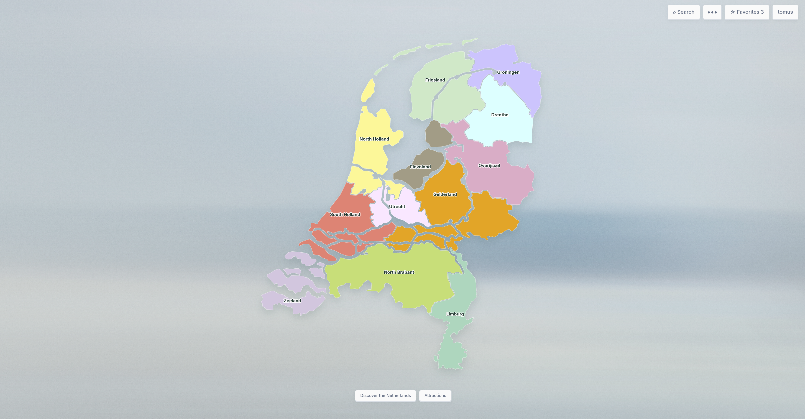

# Netherlands Explorer

An interactive travel atlas for exploring the Netherlands.

Discover 12 provinces, 40 cities and 40 attractions through a fullscreen map, searchable directories and sliding panels.



## Features

- Interactive map with province zoom and city selection.
- Search by English and local place names.
- Descriptions and history of provinces and cities.
- Attraction details with links to official websites.
- Shareable URLs: the selected province, city and panel are reflected in the address bar.
- User registration and sign-in.
- Personal favorites.
- Public comments with the option to delete your own.
- Responsive layout with sliding panels.

The map is schematic, and city positions are approximate. Attraction images currently use labeled placeholder illustrations.

## Technology

| Part     | Technologies                                   |
| -------- | ---------------------------------------------- |
| Frontend | React, React Router, JavaScript, CSS, Vite     |
| Backend  | Python, FastAPI, Uvicorn                       |
| Database | SQLite                                         |
| Tooling  | pytest, httpx, Black, Prettier, GitHub Actions |

## Quick Start

### Requirements

- Python 3.11 or newer
- Node.js 22.12 or newer

### Run the application

The frontend is not committed to the repository, so build it once before the first start. Run all commands from the project root unless stated otherwise.

**Python 3.11 or newer is required.** Check your version first:

```bash
python3 --version
```

If it prints 3.10 or lower (the system Python on macOS is 3.9), install a newer Python:

- macOS: download the installer from [python.org/downloads](https://www.python.org/downloads/), or run `brew install python@3.12`
- Windows: install from [python.org/downloads](https://www.python.org/downloads/) and tick "Add Python to PATH"

Then follow these steps:

```bash
# 1. Clone the repository
git clone https://github.com/TymurTo/netherlands-explorer.git
cd netherlands-explorer

# 2. Build the frontend
cd frontend
npm install
npm run build
cd ..

# 3. Create and activate a virtual environment
python3.12 -m venv .venv           # macOS / Linux (use the version you installed)
source .venv/bin/activate          # macOS / Linux
# py -3.12 -m venv .venv           # Windows (PowerShell)
# .venv\Scripts\Activate.ps1       # Windows (PowerShell)

# 4. Check that the environment uses the right Python
python --version                   # must print 3.11 or newer

# 5. Install backend dependencies
pip install -r backend/requirements.txt

# 6. Start the server
python backend/run.py
```

Open **http://127.0.0.1:8000** in your browser. Press `Ctrl+C` to stop the server.

The SQLite database (`backend/atlas.sqlite3`) is created automatically on the first start.

#### Troubleshooting

| Problem | Fix |
| --- | --- |
| `No matching distribution found for fastapi` | The environment was created with an old Python. Run `deactivate`, `rm -rf .venv`, then recreate it with Python 3.11 or newer. |
| `No such file or directory: backend/requirements.txt` or `.venv/bin/activate` | You are not in the project root. Run `cd` to the `netherlands-explorer` folder. |
| `Frontend build missing` | Run `cd frontend && npm install && npm run build`, then start the server again. |
| `command not found: python3.12` | That version is not installed. Install it, open a new terminal window, and try again. |

### Explore the map

1. Select a province to zoom in.
2. Select a city to view its description and history.
3. Open Attractions to browse places.
4. Use Search or the ••• menu to find another location.

### Favorites and comments

Create an account to save attractions and post comments.

Sign in using your username and password, not an email address. Visitors can read comments without signing in.

## Development

### Frontend with hot reload

Run the backend and the Vite dev server in two terminals. The backend only needs a built frontend to serve the production app, so for hot reload you can skip the build step.

```bash
# Terminal 1: API on http://127.0.0.1:8000
python backend/run.py

# Terminal 2: frontend on http://localhost:5173
cd frontend
npm install
npm run dev
```

The Vite dev server proxies `/api` requests to the backend.

To rebuild the production bundle served by FastAPI:

```bash
cd frontend
npm run build
```

### Tests

Backend (pytest):

```bash
cd backend
pip install -r requirements-dev.txt
pytest
```

The backend tests cover the full user flow (registration, sessions, favorites, comments), data isolation between users, input validation, CSRF protection, the login rate limit and the consistency of the catalog data. Each test uses a temporary database, so your local data is never touched.

Frontend (Node test runner):

```bash
cd frontend
npm install
npm test
```

The frontend tests cover URL routing helpers, form validation and the rendered application.

### Code style

```bash
cd backend && black .              # Python
cd frontend && npm run format      # JavaScript, JSX, CSS
```

### Continuous integration

GitHub Actions runs on every push and pull request:

- **backend:** `black --check` and `pytest`
- **frontend:** `prettier --check`, `npm test` and `npm run build`

### Configuration

All settings have working defaults for local development. Override them with environment variables:

| Variable              | Default                                         | Purpose                                                                                      |
| --------------------- | ----------------------------------------------- | -------------------------------------------------------------------------------------------- |
| `DATABASE_PATH`       | `backend/atlas.sqlite3`                         | Location of the SQLite database file                                                         |
| `COOKIE_SECURE`       | `0`                                             | Set to `1` to mark the session cookie as HTTPS-only                                          |
| `ALLOWED_ORIGINS`     | `localhost` and `127.0.0.1` on ports 5173, 8000 | Comma-separated list of origins allowed to send write requests                               |
| `FORWARDED_ALLOW_IPS` | empty (no proxy trusted)                        | Comma-separated IPs of reverse proxies whose forwarded headers are trusted for the client IP |

## Project structure

```
.
├── .github/workflows/ci.yml   # CI: backend and frontend checks
├── docs/screenshot.png
├── backend/
│   ├── run.py                 # entry point: starts Uvicorn
│   ├── pyproject.toml         # Black and pytest settings
│   ├── requirements.txt
│   ├── requirements-dev.txt
│   ├── app/
│   │   ├── main.py            # FastAPI app and middleware setup
│   │   ├── config.py          # paths, cookie, origins, rate limit settings
│   │   ├── schemas.py         # Pydantic request validation
│   │   ├── core/              # database, security, middleware, catalog store
│   │   ├── routes/            # auth, catalog, comments, favorites
│   │   └── data/              # catalog.json, schema.sql
│   └── tests/test_api.py      # API tests
├── frontend/
│   ├── src/
│   │   ├── api/               # API client and input validation
│   │   ├── components/        # map, controls, modal, auth form
│   │   ├── features/          # screens and sliding panels
│   │   ├── state/             # React contexts: session, catalog, favorites, navigation, notices
│   │   ├── hooks/             # custom hooks
│   │   ├── utils/             # URL routing and search helpers
│   │   ├── data/map.json      # SVG paths of the provinces
│   │   └── styles/
│   └── tests/                 # frontend tests (node:test)
└── scripts/                   # trace_map.py (map image to SVG paths) and its requirements
```

`frontend/dist/` is generated by `npm run build` and is not committed. FastAPI serves it in production.

## API overview

| Method | Endpoint                         | Auth | Description                       |
| ------ | -------------------------------- | ---- | --------------------------------- |
| GET    | `/api/health`                    | no   | Health check                      |
| GET    | `/api/catalog`                   | no   | Provinces, cities and attractions |
| POST   | `/api/auth/register`             | no   | Create an account and sign in     |
| POST   | `/api/auth/login`                | no   | Sign in                           |
| POST   | `/api/auth/logout`               | yes  | Sign out                          |
| GET    | `/api/auth/me`                   | yes  | Current user                      |
| GET    | `/api/favorites`                 | yes  | List favorite attraction ids      |
| PUT    | `/api/favorites/{attraction_id}` | yes  | Add a favorite                    |
| DELETE | `/api/favorites/{attraction_id}` | yes  | Remove a favorite                 |
| GET    | `/api/attractions/{id}/comments` | no   | Comments, newest first, paginated |
| POST   | `/api/attractions/{id}/comments` | yes  | Add a comment                     |
| DELETE | `/api/comments/{comment_id}`     | yes  | Delete your own comment           |

Write requests (`POST`, `PUT`, `DELETE`) must include the `X-Atlas-Request: 1` header. The frontend sends it automatically.

Interactive API documentation is available at **http://127.0.0.1:8000/docs** while the server is running.

## Security notes

- Passwords are hashed with scrypt and a per-user random salt.
- Session tokens are random, stored in the database only as SHA-256 hashes, and sent in an `HttpOnly`, `SameSite=Lax` cookie.
- Write requests require a custom header and a trusted `Origin` as CSRF protection.
- Login and registration are rate-limited per IP address (20 attempts per 10 minutes).
- Login takes the same amount of work whether or not the username exists, which limits user enumeration through response timing.
- All SQL queries are parameterized, and user input is validated with Pydantic.

## Limitations and roadmap

- Attraction photos are placeholders.
- Behind a reverse proxy, set `FORWARDED_ALLOW_IPS` to the proxy address. Otherwise the rate limiter sees every request as coming from the proxy.
- Comment pagination uses offsets, which can shift if new comments arrive while browsing.
- Planned: real attraction photos and a deployed demo.
